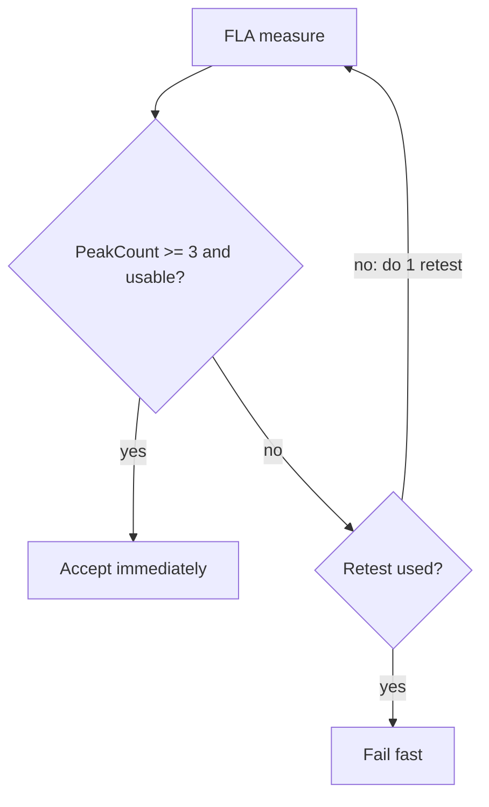

# 三峰门禁轻量采纳（缓解超时）

## 问题与目标

当前 [`ZeroConsistencyEvaluator`](OFDRCentralControlServer/Core/ZeroConsistencyEvaluator.cs) + [`ExecuteZeroWithVerificationAsync`](OFDRCentralControlServer/Core/MeasurementWorker.cs) 在首次可疑后，要求再凑 **两次**「不可疑 + 位置≤0.1m + 强度≤3dB」才采纳，最坏 **3 次** FLA，拉长独占锁时间导致客户端超时。

现场规律：**正常 zero/scan ≥ 3 峰；偶发 1 峰是异常帧**。优化目标是拦截单峰，同时把成功路径压回接近「1 次，偶发 2 次」。

## 选定策略（已确认）

- **主信号**：`PeakCount < 3`（或无峰 / 峰位峰强数量不齐）→ 坏帧
- **补测**：最多 **1** 次（`RetestCount=1` → 总尝试 2）
- **直接采纳**：坏帧之后，下一次只要峰数够且可选出有效峰 → **立即采纳**，不做位置/强度二次收敛
- **scan 同步**：固定策略 scan 与 predictive scan 都加同样的三峰门禁 + 单次补测
- **次要规则降级**（避免把已是三峰的好帧再拖进补测）：
  - 关闭/不再用于拒绝：`history jump`、`threshold margin`、`db convergence`、位置收敛
  - 保留硬拒绝：无峰、峰数不足、峰位/峰强数量不齐；窗口越界仍可作为硬拒绝（物理不可能）

## 实现要点

### 1. 简化归零判定 — [`ZeroConsistencyEvaluator.cs`](OFDRCentralControlServer/Core/ZeroConsistencyEvaluator.cs)

改写 `Evaluate`：

1. `AssessSuspiciousReason` 只保留：`no peak` / `peak count mismatch` / `PeakCount < MinPeakCount` / 可选 `outside scan window`
2. 首次不可疑 → `ShouldAccept=true`（现状保留）
3. **关键变更**：`previous.IsSuspicious` 且本次不可疑 → **`ShouldAccept=true`**（不再 `false` 等第三次）
4. 删除对 `ConvergenceToleranceM` / `DbConvergenceToleranceDb` 的接受条件依赖（字段可留配置兼容，但不再挡采纳）

默认/配置：

- [`ConfigLoader.cs`](OFDRCentralControlServer/ConfigLoader.cs) + [`ServerConfig.json`](OFDRCentralControlServer/ServerConfig.json)：`ZeroMinPeakCount: 3`，`ZeroRetestCount: 1`
- `ZeroHistoryJumpThresholdM` / `ZeroThresholdMarginDb` / `ZeroDbConvergenceToleranceDb` 保留键以免旧配置反序列化报错，但 evaluator 不再用它们拒绝

### 2. Worker 归零循环 — [`MeasurementWorker.cs`](OFDRCentralControlServer/Core/MeasurementWorker.cs)

`ExecuteZeroWithVerificationAsync` 逻辑可基本不动（仍按 `ShouldAccept` 循环）；因 evaluator 变更，坏→好 会在第 2 次返回。更新注释与失败文案（由 “did not converge” 改为更贴切的 “insufficient peaks after retest”）。

### 3. Scan 三峰门禁（新建轻量路径，复用同一判定思想）

当前 [`ExecuteFixedStrategyScanAsync`](OFDRCentralControlServer/Core/MeasurementWorker.cs) 只看 `Scan_Len > 0`，**不看峰数**，单峰会被当正常。

改动：

- [`FlaInstrumentAdapter.ScanLengthAsync`](OFDRCentralControlServer/Devices/FlaInstrumentAdapter.cs)：返回值扩展为带 `PeakCount` / `PeakDbCount`（与 `ZeroLengthAsync` 对齐）；内部已有 `GetScanCandidateSetAsync` 的 `RawPositionsCount` / `RawDbCount`
- 新增 `ExecuteScanWithPeakGateAsync`（或改造 `ExecuteFixedStrategyScanAsync`）：
  - 测一次；峰数 `< MinPeakCount` 或 length≤0 → 延迟后最多再测 1 次
  - 峰数 ≥ 3 且 length>0 → 立即成功
  - 两次仍不足 → fail，错误中带峰数摘要
- [`ExecutePredictiveScanAsync`](OFDRCentralControlServer/Core/MeasurementWorker.cs)：在采纳 `evaluation.Best` 前检查 `candidateSet.RawPositionsCount >= MinPeakCount`；不足则走同一「最多 1 次补测、够峰即采纳」；低置信度收敛逻辑可保留，但 **峰数门禁优先**（不够峰先补测，不进入耗时评分纠缠）

配置：复用 `ZeroMinPeakCount` / `ZeroRetestCount` / `ZeroRetestDelayMs` 作为 scan 门禁默认值（超时缓解优先，避免再加一套配置）；若需独立可后续再拆 `ScanMinPeakCount`。

### 4. 测试更新 — [`ZeroConsistencyEvaluatorTests.cs`](OFDRCentralControlServer/OFDRCentralControlServer.Tests/ZeroConsistencyEvaluatorTests.cs)

- 默认 `MinPeakCount: 3`
- **改写**：`ValidMeasurementAfterSuspiciousPrevious` → 应变为 **ShouldAccept=true**
- **改写/删除**：依赖二次收敛、history jump、threshold margin、db jump 拒绝的用例（改为「不再拒绝」或移除）
- **保留/加强**：单峰可疑、无峰、mismatch、三峰直接采纳、坏→好第 2 次采纳
- 新增 scan 峰数门禁单元测试（可抽 `PeakCountGate` 静态辅助或复用 evaluator 的 suspicious 子集，避免两套规则漂移）

建议把「是否够峰/是否可用」抽成小函数（如 `PeakFrameGate.IsAcceptable(peakCount, peakDbCount, selectedPos, options)`），zero/scan 共用，防止规则分叉。

### 5. 验证

- `dotnet test`（`OFDRCentralControlServer.Tests`）
- 用日志序列自检：`1pk` → 补测 `≥3pk` → `accepted` 且 `attempts=2`（不再出现 attempts=3 才收敛）

## 预期效果

| 场景 | 改前 | 改后 |
|------|------|------|
| 首次 ≥3 峰 | 1 次 | 1 次 |
| 首次 1 峰，第二次正常 | 常需 3 次 | **2 次即采纳** |
| 三峰但强度/历史轻微波动 | 可能补测/失败 | **直接过** |
| scan 单峰 | 可能当成功 | 拦截并最多补测 1 次 |

## 明确不做

- 不改客户端超时（服务端先把墙钟压回去）
- 不恢复 `SendResultAsync` 推送（与本次超时根因正交，可另开任务）
- 不回滚整段一致性框架，只瘦身为三峰门禁 + 单次补测
